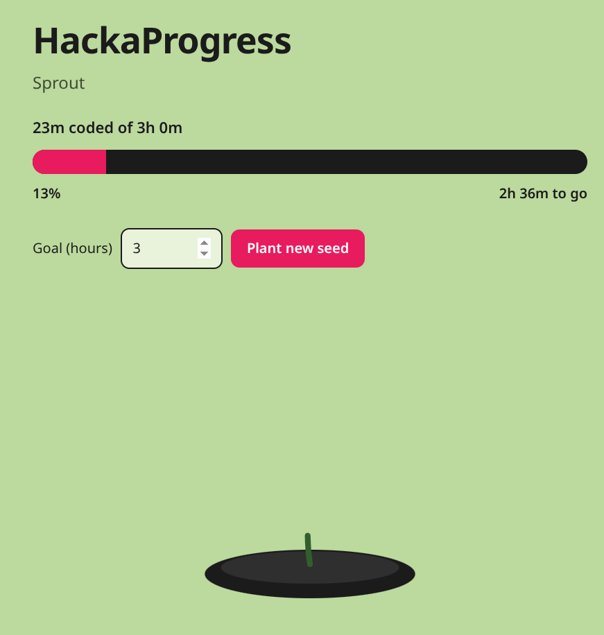

# HackaProgress
Set a coding hour goal and watch the progress bar and a plant that grows with it

## Description

HackaProgress is a web app that shows your coding time as a growing plant. You choose a goal (like 3 hours). The app checks the Hackatime API to see how long you have been coding since you planted your seed. A live progress bar and a plant that starts as a seed grows leaves. Finally blooms update every 15 seconds as you work.

It uses a Python Flask backend that connects to Hackatime and saves your goal in a JSON file. It also has a HTML page that asks the backend, for updates and shows an SVG plant that moves and changes.

### Screenshots

## Getting Started

### Dependencies

1. Python 3.10 or newer
2. Your Hackatime API key, you can find it here:https://hackatime.hackclub.com/my/settings/setup
3. Works on any Operating System (develop on Fedora 45)
4. Python Libraries in requirements.txt

### Installing

1. Download the project from github:

git clone https://github.com/taty-pain/HackaProgress.git
cd HackaProgress

2. Create a virtual environment (optional)

Linux & macOS:
python3 -m venv .venv
source .venv/bin/activate

Windows:
py -m venv .venv
.venv\Scripts\Activate\.ps1

3. Installing the libraires

python -m pip install -r requirements.txt

4. Add your API key
* Copy `.env.example` to `.env`
     * macOS / Linux: `cp .env.example .env`
     * Windows: `copy .env.example .env`
   * Open `.env` in any editor and replace `paste-your-key-here` with your real key

### Executing Program
1. Make sure your virtual environment is active
2. Run python app.py
3. Go to http://127.0.0.1:5000 in your browser (AFTER RUNNING YOUR CODE)
4. Enter your coding time goal and press "Plant new seed"
5. Press Ctrl+C in your terminal if you want to quit the program  

## Help

* **`python` or `python3` not found:** on Windows use `py` instead; on macOS / Linux use `python3`. After you activate the virtual environment, plain `python` works everywhere.
* **PowerShell says running scripts is disabled:** run `Set-ExecutionPolicy -Scope CurrentUser RemoteSigned`, then activate again.
* **The page shows an error about the API key:** check that `.env` exists, contains `HACKATIME_API_KEY=...`, and that the key is correct. Then restart the app.
* **Progress stays at 0%:** the bar counts time since you pressed **Plant new seed**. Make sure your editor's WakaTime plugin is running, and note that Hackatime updates about every 30 seconds.
* **Page looks old after an edit:** do a hard refresh with `Ctrl+Shift+R` (`Cmd+Shift+R` on macOS).
* **Test the connection by itself:** open http://127.0.0.1:5000/api/today(AFTER RUNNING YOUR CODE). It should show your seconds coded today.

## License

This project is licensed under the MIT License - see the LICENSE.md file for details